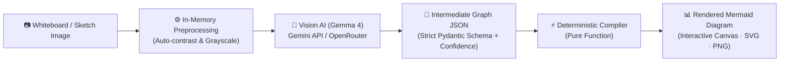

# DiagramFlow

<p align="center">
  <strong>Turn whiteboard photos, hand-drawn sketches, and architecture drafts into clean, editable, and deterministic Mermaid diagrams.</strong>
</p>

<p align="center">
  <a href="LICENSE"></a>
  
  
  
  
  
  
</p>

---

## Overview

Whiteboard photos and whiteboard sketches are notoriously tricky for AI vision models: uneven lighting, glare, low contrast, messy handwriting, and ambiguous connectors make directly generating raw diagram syntax error-prone and brittle.

**DiagramFlow** solves this with a **three-stage pipeline**:



1. **Pre-processing**: Normalizes contrast and converts to grayscale in-memory via Pillow to make faint marker strokes pop.
2. **Intermediate Graph Extraction**: Instructs vision models (Gemma 4 via Gemini or OpenRouter) to extract structured nodes, shapes, connectors, confidence scores, and alternative candidates rather than raw Mermaid text.
3. **Deterministic Compilation**: A pure Python compiler translates the validated `DiagramGraph` into standard, error-free Mermaid syntax in milliseconds—enabling instant local recompilation whenever connections are adjusted.

---

## Features

- **Multi-Diagram Recognition**:
  - **Flowcharts & Architecture (`flowchart TD | LR`)**: Recognizes 6 distinct shapes (rectangle, rounded, diamond, cylinder, circle, hexagon), connection styles (solid, dashed, thick, bidirectional), edge labels, and subgraphs/VPCs.
  - **Sequence Diagrams (`sequenceDiagram`)**: Extracts actors/lifelines, sequential calls and returns, autonumbering, and arrow styles (`solid`, `dashed`, `bidirectional`).
  - **Entity-Relationship Diagrams (`erDiagram`)**: Captures database entities, typed attributes, Primary Keys (`PK`), Foreign Keys (`FK`), and cardinalities (`1:1`, `1:N`, `0:N`, `M:N`).
  - **Class Diagrams (`classDiagram`)**: Parses UML classes with methods/attributes and relationships (inheritance `<|--`, composition `*--`, aggregation `o--`, association `-->`, dependency `..>`).
- **Confidence Scoring & Ambiguity Support**:
  - Edges carry confidence levels (`high` vs. `low`) and candidate `alternatives` so clients can review or toggle uncertain connections without calling the model again.
- **Multiple Provider Backends**:
  - **Google Gemini API**: Native support for Gemma 4 models (`gemma-4-26b-a4b-it`, `gemma-4-31b-it`).
  - **OpenRouter**: OpenAI-compatible endpoint supporting `google/gemma-4-31b-it` and compatible vision models.
  - **Deterministic Mock**: Offline, zero-credential mock provider for local development and instant UI testing.
- **Interactive Web App**:
  - Built with React 19, TypeScript, and Tailwind CSS v4.
  - Drag-and-drop file upload supporting PNG, JPEG, and WebP (up to 10 MB).
  - Pan and zoom controls (drag to pan, wheel/button zoom, reset view, fullscreen).
  - High-resolution export to **SVG** and 2x crisp **PNG**.
- **Privacy-First & Stateless**:
  - Uploaded images and generated graphs are processed strictly in-memory and are never stored on disk or in a database.

---

## Repository Structure

```text
diagramflow/
├── backend/
│   ├── src/backend/
│   │   ├── compiler.py          # Deterministic Mermaid compiler (pure functions)
│   │   ├── image_processing.py  # Pillow auto-contrast & grayscale validation
│   │   ├── main.py              # FastAPI app, CORS middleware, /v1/diagrams:extract
│   │   ├── models.py            # Pydantic schemas (DiagramGraph discriminated unions)
│   │   └── providers.py         # Gemini, OpenRouter, and Mock provider drivers
│   ├── tests/
│   │   ├── test_api.py          # API route & validation tests
│   │   ├── test_compiler.py     # Compiler fidelity tests across all diagram types
│   │   └── test_providers.py    # Provider integration & fallback tests
│   ├── pyproject.toml           # Python package configuration
│   └── requirements.txt         # Pinned backend dependencies
├── frontend/
│   ├── src/
│   │   ├── App.tsx              # Interactive diagram workspace & export engine
│   │   ├── main.tsx             # React DOM entrypoint
│   │   └── index.css            # Tailwind & UI styles
│   ├── package.json             # Vite, React 19, Mermaid.js dependencies
│   └── vite.config.ts           # Vite configuration
├── docs/
│   ├── adr/                     # Architecture Decision Records
│   ├── frontend-handoff.md      # API integration specs & JSON schema contracts
│   └── glossary.md              # Domain terminology & definitions
├── main.py                      # Root FastAPI entrypoint for quick launch
├── LICENSE                      # MIT License
└── README.md                    # Project documentation
```

---

## Getting Started

### Prerequisites

- **Python 3.11+**
- **Node.js 18+** or **Bun**
- *(Optional)* Gemini API Key or OpenRouter API Key for live AI extraction.

---

### Backend Setup

1. **Navigate to the backend directory and set up a virtual environment:**

   ```bash
   cd backend
   python3 -m venv .venv
   source .venv/bin/activate
   pip install -r requirements.txt
   ```

2. **Configure Environment Variables:**

   Create a `.env` file in `backend/` (or set environment variables in your shell):

   ```env
   # Choice of provider: "gemini", "openrouter", or "mock" (default if no key)
   DIAGRAM_PROVIDER=gemini

   # For Google Gemini / Gemma 4:
   GEMINI_API_KEY=your_gemini_api_key_here
   GEMINI_MODEL=gemma-4-26b-a4b-it

   # For OpenRouter:
   # DIAGRAM_PROVIDER=openrouter
   # OPENROUTER_API_KEY=your_openrouter_api_key_here
   # OPENROUTER_MODEL=google/gemma-4-31b-it

   # CORS allowlist (comma-separated, defaults to http://localhost:5173)
   CORS_ORIGINS=http://localhost:5173
   ```

3. **Start the API Server:**

   ```bash
   # From the repository root:
   python main.py

   # Or using uvicorn directly:
   uvicorn backend.main:app --reload --port 8000
   ```

   The backend will be available at `http://localhost:8000`. You can verify health via:

   ```bash
   curl http://localhost:8000/healthz
   # {"status":"ok"}
   ```

---

### Frontend Setup

1. **Navigate to the frontend directory and install dependencies:**

   ```bash
   cd frontend
   npm install
   ```

2. **Configure Environment Variables (optional):**

   By default, Vite points to `http://localhost:8000`. You can customize this by creating `frontend/.env`:

   ```env
   VITE_API_BASE_URL=http://localhost:8000
   ```

3. **Run the Development Server:**

   ```bash
   npm run dev
   ```

   Open `http://localhost:5173` in your browser.

---

## API Specification

### `POST /v1/diagrams:extract`

Accepts a `multipart/form-data` request containing a single `image` field.

- **Supported Formats**: PNG, JPEG, WebP.
- **Maximum Size**: 10 MB.
- **Headers**: `Content-Type: multipart/form-data`

#### Example Request

```bash
curl -X POST http://localhost:8000/v1/diagrams:extract \
  -F "image=@/path/to/whiteboard.png"
```

#### Example Response

```json
{
  "graph": {
    "diagram_type": "flowchart",
    "direction": "TD",
    "nodes": [
      { "id": "start", "label": "Start", "shape_type": "rounded" },
      { "id": "review", "label": "Review request", "shape_type": "diamond" },
      { "id": "approved", "label": "Approved", "shape_type": "rectangle" },
      { "id": "rework", "label": "Rework", "shape_type": "rectangle" }
    ],
    "edges": [
      { "source": "start", "target": "review", "confidence": "high", "alternatives": [] },
      { "source": "review", "target": "approved", "label": "yes", "confidence": "high", "alternatives": [] },
      { "source": "review", "target": "rework", "label": "no", "confidence": "low", "alternatives": ["approved"] }
    ],
    "subgraphs": []
  },
  "mermaid": "flowchart TD\n    start(\"Start\")\n    review{\"Review request\"}\n    approved[\"Approved\"]\n    rework[\"Rework\"]\n    start --> review\n    review -->|yes| approved\n    review -->|no| rework",
  "provider": "gemini"
}
```

### `GET /healthz`

Returns `{"status": "ok"}` for container readiness and liveness checks.

---

## Testing & Quality

Run the backend unit test suite:

```bash
python3 -m unittest discover -s backend/tests -v
```

Lint frontend code:

```bash
cd frontend && npm run lint
```

Build frontend production assets:

```bash
cd frontend && npm run build
```

---

## Architecture Decisions

For detailed design rationale, refer to our Architecture Decision Records:
- [ADR 0001: Compile Mermaid from a validated intermediate graph](docs/adr/0001-intermediate-graph-contract.md)
- [ADR 0002: Process images statelessly in v1](docs/adr/0002-stateless-image-extraction.md)
- [Glossary of Terms](docs/glossary.md)
- [Frontend Integration Guide](docs/frontend-handoff.md)

---

## Contributing

Contributions are welcome! Please open an issue or pull request to discuss bug fixes, new diagram compiler targets, or UI enhancements.

1. Fork the repository.
2. Create your feature branch (`git checkout -b feature/amazing-feature`).
3. Commit your changes (`git commit -m 'Add amazing feature'`).
4. Push to the branch (`git push origin feature/amazing-feature`).
5. Open a Pull Request.

---

## License

This project is licensed under the **MIT License**. See the [LICENSE](LICENSE) file for details.

